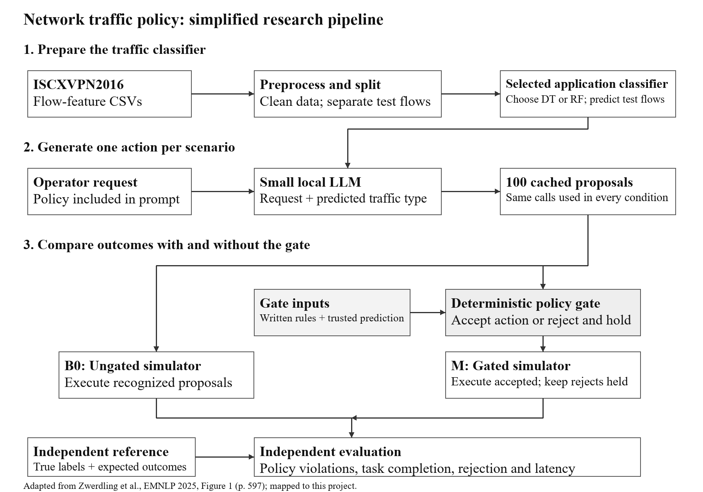

# Deliverable 4: Research methodology diagram

## Published design and project mapping

The architecture adapts **Figure 1, p. 597**, in Zwerdling et al., *Towards Enforcing Company Policy Adherence in Agentic Workflows*, EMNLP Industry Track (2025), [official paper](https://aclanthology.org/anthology-files/pdf/emnlp/2025.emnlp-industry.41.pdf#page=3). Its policy-preparation and pre-tool checking stages fit our experiment more closely than a generic flowchart.

| Published component | Project component |
|---|---|
| Policy documents, toolkit and data schema | Three rules, three action schemas and flow IDs. |
| Tool-policy mapping | Manually reviewed policy-to-action table. |
| ToolGuard | Handwritten deterministic gate. |
| System snapshot | Trusted application prediction and current simulator state. |
| Guard before action | Mandatory check before simulator execution. |

Our adaptation adds traffic-classifier preparation and independent outcome scoring. It uses manual rule implementation rather than the paper's automated guard generation. The primary trial ends after one proposal; rejected actions are held rather than sent through a revision loop. The diagram is a project adaptation of the published structure.

## Comparison protocol

The same 100 cached proposals enter B0, B1 and M on separately reset simulator copies. Dataset labels support independent scoring and prediction-error analysis without extra LLM calls.

| Diagram stage | Methodology steps |
|---|---|
| 1. Prepare the traffic classifier | Steps 1–4 and classifier selection in Step 5. |
| 2. Generate one action per scenario | Agent setup in Step 5 and the 100-scenario experiment in Step 7. |
| 3. Compare outcomes with and without the gate | Gate/rules in Step 5; B0/B1/M in Step 6; metrics, statistics, ablation and errors in Steps 8–11. |
| Final output from evaluation | Step 12: report, saved outputs and reproducible pipeline. |

## Architecture

**Figure 1.** Select one trained classifier, generate 100 action proposals, then compare ungated and gated simulator outcomes on separately reset state. The gate reads trusted predictions directly. Independent evaluation scores executed actions and rejections against dataset labels and reviewed expectations. B1 uses the gated path with application-policy checks disabled.

